# pm2-liveness

[](https://www.npmjs.com/package/pm2-liveness) [](https://github.com/Aareez01/pm2-liveness/actions/workflows/ci.yml) [](./LICENSE) [](#requirements)

Active liveness and readiness probes for PM2. Detects hung-but-alive processes and
restarts **only the failing instance**.

PM2 reports a process as `online` whenever its OS process is alive. A Node app with a
blocked event loop, an exhausted connection pool, or one returning 503 to every request
is `online` by that definition and will never be restarted. PM2's only health signals are
*crash* and *memory ceiling*. `pm2-liveness` adds the missing one.

```
pm2 install pm2-liveness
pm2 set pm2-liveness:apps '{"api":{"liveness":{"http":{"path":"/health"}}}}'
```

By default it **observes and reports but never restarts**. See [Actions](#actions).

---

## See it work

A two-instance app. One instance starts returning 503 while its process stays
perfectly alive - the exact case PM2 cannot see.



PM2 reported both instances as `online` with zero restarts the whole time. That is
not a bug in PM2: a crash and a memory ceiling are the only health signals it has.

Instance 1 came back with a new pid and a reset uptime. **Instance 0 was never
touched** - which is the part that matters, because restarting a whole app to fix
one bad worker is its own outage.

<details>
<summary>The same run as copyable text</summary>

```
1. Start an app with two instances
  instance 0  pid 259017  up 3s
  instance 1  pid 259024  up 3s

2. Install pm2-liveness and point it at /health
  watching /health on every instance, every 2s

3. Break instance 1 - it returns 503 but the process stays alive
$ curl -s http://127.0.0.1:3001/break
broken

  PM2's own view, which is the whole problem:
  instance 0  status online  restarts 0
  instance 1  status online  restarts 0
  ...both still 'online'. PM2 only sees crashes and memory limits.

4. pm2-liveness notices, and restarts only the broken instance
  restarting instance  app=api pm_id=1 reason=status 503
  instance 0  pid 259017  up 20s
  instance 1  pid 259327  up 4s

  instance 1 has a new pid and a reset uptime. Instance 0 was never touched.

5. And it is serving again
$ curl -s http://127.0.0.1:3001/health
{"ok":true,"pid":259327}
```

</details>

Run it yourself - it is self-contained, uses an isolated `PM2_HOME`, binds only to
loopback, and cleans up after itself:

```bash
git clone https://github.com/Aareez01/pm2-liveness
cd pm2-liveness/demo && ./demo.sh
```

The recording is `demo/demo.cast` ([asciinema](https://asciinema.org) format) and the
animation above is generated from it by `demo/cast2svg.py`.

## Why can't I configure this in `ecosystem.config.js`?

**Because PM2 would silently throw your configuration away.**

This is the single most common surprise, so it is worth being precise. PM2 validates every
app definition through `Config.validateJSON`, which builds its result as a *whitelist*: it
iterates the ~65 keys in its own schema, copies matching keys into a fresh object, and
discards everything else. Verified against PM2 7.1.1:

| Key in `ecosystem.config.js` | Survives into `pm2_env`? |
| --- | --- |
| `probe: { ... }` | **No** |
| `pm2_ops: { ... }` | **No** |
| `name`, `script`, `env`, `increment_var` | Yes |

No warning is printed. The key simply vanishes. So `pm2-liveness` is configured through one
of the two channels below instead.

### Channel 1 - module config (simple setups)

```bash
pm2 set pm2-liveness:apps '{"api":{"liveness":{"http":{"path":"/health"},"periodSeconds":10}}}'
```

`pm2 set` restarts the module automatically, so the change takes effect immediately.

### Channel 2 - a sidecar file (recommended beyond a couple of apps)

```bash
pm2 set pm2-liveness:configFile /etc/pm2-liveness/config.yaml
```

```yaml
logLevel: info
reconcileSeconds: 30

endpoint:
  enabled: false          # off by default; see Health endpoint
  host: 127.0.0.1
  port: 9615

apps:
  api:
    action: restart       # 'none' (default) observes only
    scope: instance       # or 'app'
    minHealthy: auto      # max(1, half) for clusters; 0 for single-instance apps
    restartBudget:
      max: 3
      windowSeconds: 600
    liveness:
      http:
        path: /health
        port: auto        # resolved per instance from pm2_env
        expectStatus: [200, 299]
      periodSeconds: 10
      timeoutSeconds: 3
      failureThreshold: 3
      initialDelaySeconds: 15
    readiness:
      http: { path: /readyz }
      periodSeconds: 5
```

The file is watched and reloaded without a module restart. A bad edit is rejected and the
previous configuration keeps running. The sidecar file wins if both channels are set, and
the module logs which one it used at boot.

---

## Probe types

| Type | Config | Notes |
| --- | --- | --- |
| `http` | `{ path, port, host, scheme, method, expectStatus, bodyMatch, headers, insecure }` | `port: auto` resolves per instance |
| `tcp` | `{ port, host }` | succeeds on connect; writes nothing |
| `exec` | `{ command, env }` | exit `0` passes; killed by process group on timeout |
| `loopLag` | `{ maxLagMs, metricName }` | reads PM2's own event-loop metric |

A timeout counts as a failure, not an error to retry.

`loopLag` reads the event-loop figure PM2 already publishes. **PM2 7 populates
`Event Loop Latency` (p50) and `Event Loop Latency p95` for every app with no
instrumentation at all**, so this works out of the box:

```yaml
liveness:
  loopLag: { maxLagMs: 200 }      # defaults to the p50 metric
  failureThreshold: 3
```

Set `metricName` to target a specific metric, such as `Event Loop Latency p95`, or one
your own instrumentation publishes. If the named metric is absent the app is **refused
rather than probed** - a probe that reads "no data" as "healthy" reports health it never
measured.

---

## Actions

`action` defaults to **`none`**: probe, track state, emit events, never restart.

This is deliberate. A probe that restarts a healthy app because a shared database blipped
converts a degraded service into a flapping one. Run in `none` for a few days, read the
events, then switch to `restart` once the thresholds are right.

Three safety rails apply when `action: restart`:

- **Per-instance only.** A trip restarts the one failing instance via `pm2.restart(pm_id)`,
  never the whole app.
- **Restart budget.** At most `max` restarts per instance per `windowSeconds` (default 3 per
  10 min). On exhaustion the module gives up on that instance and keeps emitting events -
  restart-looping a broken app forever is worse than not restarting it.
- **Quorum.** A restart is blocked if it would leave fewer than `minHealthy` instances
  serving. `auto` means `max(1, floor(instances / 2))` for clusters and `0` for a
  single-instance app, which has no quorum to protect.

---

## Cluster mode needs per-instance ports

In PM2 cluster mode with a **shared** port, the primary routes each connection to an
arbitrary worker. An HTTP probe therefore cannot tell instances apart, and restarting a
`pm_id` would be restarting an instance the probe never actually tested.

`pm2-liveness` detects this and **refuses to probe the app** rather than guessing:

```
refusing to probe app  app=api
  reason: scope is 'instance' and 4 cluster instances share 1 port(s); PM2 routes a
          shared port to an arbitrary worker, so per-instance probing is not possible
```

A trap worth naming: **`pm2 start app.js -i 2 --env PORT=3200` does not do this.** PM2's
`--env` *selects* an `env_<name>` block; it does not set a variable. `PORT` never reaches
`pm2_env` at all and the guard fires. Use an ecosystem file with `increment_var`.

Three ways to resolve it:

1. `increment_var: 'PORT'` in your ecosystem config, so each instance binds its own port;
2. an `exec` probe, which receives `PM2_PROBE_PM_ID` and targets the instance directly;
3. `scope: 'app'`, accepting app-level probing (a trip then restarts the whole app).

Other apps keep being probed normally - one misconfigured app never takes the module down.

---

## Events

On every **transition** (never per tick) the module emits `pm2-liveness:status` on the PM2 bus.
Any process can consume it:

```js
pm2.launchBus((err, bus) => {
  bus.on('pm2-liveness:status', (m) => console.log(m.data));
});
```

```jsonc
{
  "v": 1,                      // contract version; ignore payloads you don't understand
  "state": "fail",             // "pass" | "fail" | "recovered"
  "app": "api",
  "pm_id": 1,
  "probe": "http",
  "probe_kind": "liveness",
  "reason": "status 503",
  "consecutive": 3,
  "threshold": 3,
  "action": "restart",         // what the probe DID
  "host": "web-01",
  "at": "2026-10-30T20:51:00.000Z"
}
```

This is a **wire contract**, versioned like any webhook payload. Required fields are `v`,
`state`, `app`, `pm_id`, `probe`, `probe_kind` and `at`; everything else is optional, and
consumers must tolerate unknown extra fields. New optional fields do not bump `v`; removing
or retyping one does.

> PM2 attaches its own `process` envelope to bus messages, and it identifies the **emitter**
> (`pm2-liveness`), not the subject. Read the app and instance from `data.app` / `data.pm_id`.

---

## Health endpoint

Optional, **disabled by default**, and bound to `127.0.0.1` unless you say otherwise:

```yaml
endpoint: { enabled: true, host: 127.0.0.1, port: 9615 }
```

`GET /livez` and `GET /readyz` return `200` or `503` with a per-app JSON summary. Both serve
cached state and never trigger a live probe, so a load balancer health check cannot become
an amplification vector against your app.

---

## Troubleshooting

### Every `pm2` command hangs and never returns

Your `PM2_HOME` path is too long. PM2 binds `$PM2_HOME/rpc.sock`, and Linux caps unix socket
paths (`sun_path`) at **107 characters**. Over that limit the bind fails *silently*: the
daemon starts and writes `pm2.pid` and `logs/`, but no `.sock` file is ever created and every
client - including `pm2 kill` - blocks forever. The orphaned daemon spins at 100% CPU.

```bash
echo -n "$PM2_HOME/rpc.sock" | wc -c     # must be < 107
ls "$PM2_HOME"/*.sock                    # should exist
```

Recover by killing the daemon by PID (`pkill -f "God Daemon"`) and using a shorter
`PM2_HOME`. This bites CI fixtures and containers most often.

### The module starts but probes nothing

Check `pm2 logs pm2-liveness`. Apps with no probe configured are ignored entirely, and the
module logs the app names it loaded at boot.

### Config changes aren't taking effect

`pm2 set` restarts the module for you. Hand-editing `~/.pm2/module_conf.json` does **not** -
run `pm2 restart pm2-liveness` after.

---

## Design documentation

- [`docs/requirements.md`](./docs/requirements.md) - the requirements this module was built
  against, including the reasoning behind the safety rails and two requirements that were
  revised once the implementation met reality.
- The shared platform findings and the `pm2-liveness:status` wire contract live in the
  **`pm2-ops-contract`** repository, because `pm2-alertmanager` is bound by the same contract.

## Requirements

Node 22 or newer - tested on 22, 24 and 26 - with PM2 5 or newer.

## Development

```bash
npm install
npm run build
npm test                  # unit tests
npm run test:integration  # spins up a real PM2 daemon, breaks an app, asserts the restart
```

The integration harness starts a two-instance cluster app, breaks one instance, and asserts
that only the failing instance is restarted and that the event reaches a separate subscriber
process. It uses an isolated `PM2_HOME` and asserts the socket-path limit up front.

## License

MIT
